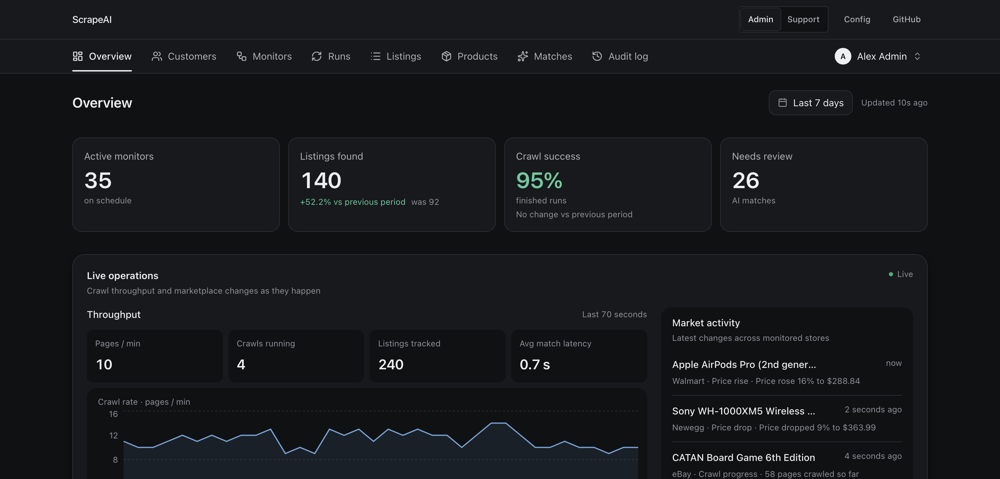

# FlowPanel

FlowPanel adds a typed admin panel to an existing Next.js app, built from your Drizzle or Prisma schema and a small config. It runs inside your app, with your database client and your auth.

[](examples/ai-scraper)

## Install

<!-- flowpanel:compatibility:start -->
| Requirement | Supported range |
| --- | --- |
| Node.js | `>=20` |
| Next.js | `^16.3.0` |
| React | `^19.0.0` |
| Drizzle ORM | `>=0.45.2 <1.0.0` |
| Prisma Client | `>=5.0.0 <7.0.0` |
<!-- flowpanel:compatibility:end -->

From the root of a Next.js App Router app:

```bash
pnpm dlx @flowpanel/cli init
pnpm flowpanel migrate
pnpm flowpanel dev
```

## Example

```ts
// flowpanel.config.ts
import { defineAdmin, resource } from "@flowpanel/kit";
import { withBetterAuth } from "@flowpanel/kit/auth";
import { drizzleAdapter } from "@flowpanel/kit/drizzle";
import { auth } from "@/lib/auth";
import { db } from "@/server/lib/db";
import * as schema from "@/server/lib/db/schema";

export default defineAdmin({
  adapter: drizzleAdapter({ db, schema }),
  auth: withBetterAuth({ auth, requireRole: "admin" }),
  resources: [resource(schema.users, { columns: ["email", "name", "createdAt"], search: ["email"] })],
});
```

Open [http://localhost:3000/admin](http://localhost:3000/admin).

## Links

- [Documentation](https://flowpanel.tech/docs/introduction/getting-started) and the [step-by-step tutorial](https://flowpanel.tech/docs/introduction/founder-admin)
- [Live demo](https://flowpanel.tech) and its source, [`examples/ai-scraper`](examples/ai-scraper); a minimal Clerk setup in [`examples/with-clerk`](examples/with-clerk)
- [Changelog](https://flowpanel.tech/changelog) and [roadmap](ROADMAP.md)
- [Contributing](.github/CONTRIBUTING.md), [Discussions](https://github.com/getflowpanel/flowpanel/discussions), [Issues](https://github.com/getflowpanel/flowpanel/issues)
- [MIT license](LICENSE)
