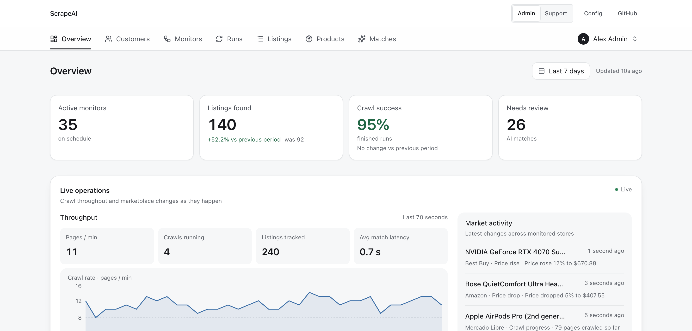

# ScrapeAI

ScrapeAI is a fictional price-intelligence SaaS. Its customers set up marketplace monitors, the runs find competing listings, and uncertain matches go to human review. This is its admin, built with FlowPanel, and the source of the live demo. Next.js, Drizzle and PostgreSQL.

<picture>
  <source media="(prefers-color-scheme: dark)" srcset="./public/scrapeai-overview-dark.png">
  
</picture>

## Run locally

Node.js 22+, pnpm and Docker. From the repository root:

```bash
pnpm install
pnpm --filter "./packages/**" build
pnpm --filter ai-scraper docker:up
pnpm --filter ai-scraper db:push
pnpm --filter ai-scraper db:migrate
pnpm --filter ai-scraper db:seed
pnpm --filter ai-scraper dev
```

Open [http://localhost:3000](http://localhost:3000) and choose **Open admin**. The Admin / Support switch shows server-enforced role differences: Support loses the pricing field and the disable action.

## Screens

- **Overview**: monitors, listings found and crawl success against the previous week, the review backlog, live crawl rate and recent runs. Each number links to the rows it counts.
- **Customers**: search, filters, inline edit, import and export. Each customer has a record page with counts, account facts and related monitors, products and invoices.
- **Monitors**: typed forms, schedule and status filters, bulk pause and resume.
- **Runs**: crawl history with throughput, duration, retries and AI usage.
- **Listings**: full-text search, marketplace, stock and date filters, export, and each listing's AI match.
- **Products**: grouped forms, customer references, field-level roles.
- **Matches**: ambiguous matches, lowest confidence first, with Confirm and Reject.
- **Audit log**: every change in your sandbox, by who, what and when. Each record's History tab shows its own changes field by field.

## Where the code is

| What | File |
| --- | --- |
| Admin config, auth, security, theme | `src/admin/config/index.ts` |
| Resources | `src/admin/config/resources/` |
| Enum labels and tones, declared once | `src/admin/config/enums.ts` |
| Customer record page | `src/admin/config/resources/customer-card.ts` |
| Overview dashboard | `src/admin/config/dashboards/overview.ts` |
| Dashboard queries | `src/admin/overview-queries.ts` |
| Live operations widget | `src/admin/LiveOperations.tsx` |
| Widget and header tests | `src/admin/__tests__/` |
| Drizzle schema | `src/db/schema.ts` |
| Demo data, personas, realtime feed and sandboxes | `src/demo/` |

`src/admin` is ordinary application code; `src/demo` is demo-only.

## Seed and reset

`db:seed` creates the `local` sandbox: 48 customers, 36 monitors, 60 products, 252 runs and 240 listings, 26 of them awaiting review. Reset it with `pnpm --filter ai-scraper demo:reset -- --sandbox local`; remove expired browser sandboxes with `pnpm --filter ai-scraper demo:cleanup -- --force`.

## Public demo

Set `DEMO_MODE=true` and a random `DEMO_SANDBOX_SECRET` of 32+ characters. Each browser then gets its own pre-filled PostgreSQL sandbox that expires after 60 minutes idle or 24 hours. At most 200 sandboxes are active, created at most 10 per hour per IP hash. Set `DEMO_TRUST_PROXY=true` only behind a proxy that rewrites forwarding headers. `DEMO_READ_ONLY=true` blocks writes, and `DEMO_LIVE=off` turns off the realtime ticker on serverless hosts.

The persona cookie is a demo mechanism; a real app uses real auth. Do not deploy the sample `.env` values.

## Queues

Without `REDIS_URL` the queue screens are absent. To try them:

```bash
docker run -d -p 6379:6379 redis:7-alpine
export REDIS_URL=redis://localhost:6379
export BOARD_SECRET=$(openssl rand -hex 32)
pnpm --filter ai-scraper dev
```

In a second terminal with the same `REDIS_URL` and `BOARD_SECRET`, start the board: `pnpm --filter ai-scraper flowpanel:board`.

Set `BOARD_URL` to a browser-reachable HTTPS origin when deployed.

## Deploy

```bash
docker build -f examples/ai-scraper/Dockerfile .
DEMO_SANDBOX_SECRET="$(openssl rand -hex 32)" \
  docker compose -f examples/ai-scraper/docker-compose.demo.yml up --build
```

Attach PostgreSQL and set `DATABASE_URL`, `DEMO_MODE=true` and `DEMO_SANDBOX_SECRET`. The container applies the schema on start; sandboxes fill on first visit.
